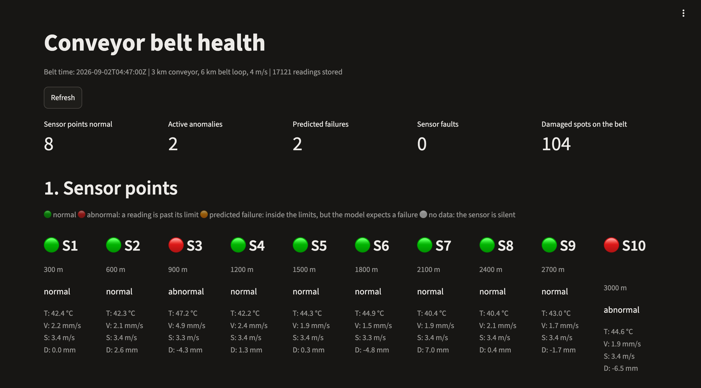
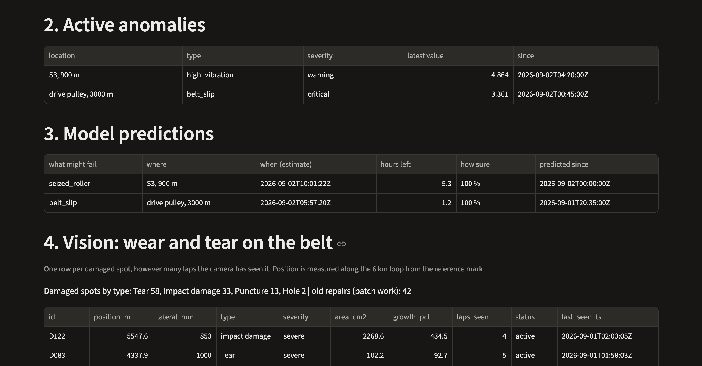
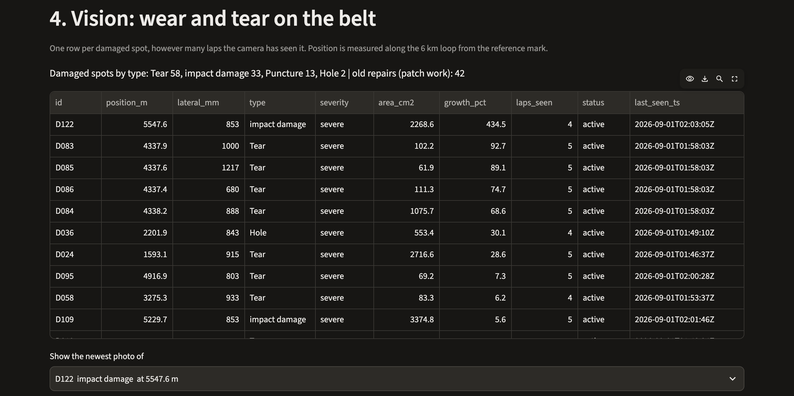
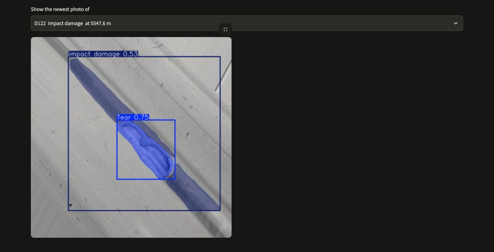
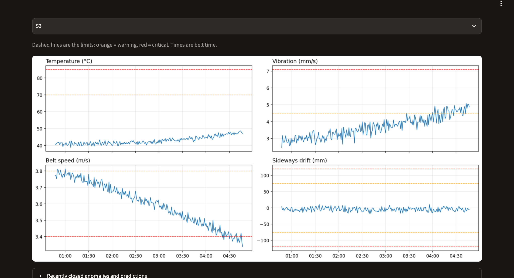
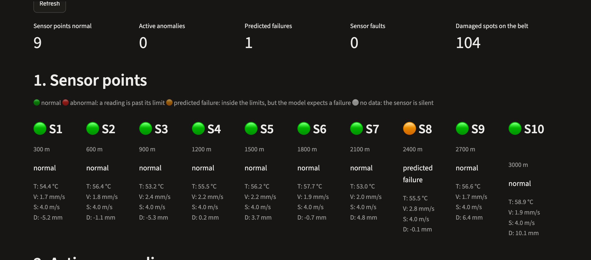

# Conveyor belt monitor

A take-home project for the AI Systems Engineer role. It monitors a simulated 3 km mining
conveyor, predicts failures before they happen, finds belt damage in images, and shows the
belt's health on a dashboard.

The design document is in [docs/DESIGN.md](docs/DESIGN.md).

## What is in the repository

| Folder | What it does |
|---|---|
| `simulator/` | Produces all sensor data: healthy signals, three failure types, and messy data. Writes a log of everything it injected. |
| `backend/` | FastAPI + SQLite. Receives readings, validates and stores them, raises anomalies, runs the prediction model, stores vision records. |
| `model/` | Features, training and testing of the failure prediction model (gradient boosting). |
| `vision/` | Damage model training, and the loop logic that turns detections from many laps into one record per damaged spot. |
| `dashboard/` | Streamlit dashboard. It reads only from the backend's HTTP API. |
| `analysis/`, `tests/` | Scripts that compare the system's output with the simulator's ground truth. |
| `notebooks/` | The two Kaggle notebooks in which I built and ran the project, with their outputs. |

The two chains from my design:

```
Sensors: simulator -> backend -> anomaly rules -> prediction model -> dashboard
Vision : camera frames -> damage model -> loop logic -> damage records -> backend -> dashboard
```

## Results in short

| Part | Measured on | Result |
|---|---|---|
| Messy data | 60 simulated days, 856,001 readings | Every injected fault was found: 845 of 845 impossible values, 2,516 of 2,516 nulls, 8,478 of 8,478 late readings, 53 of 53 outages, 60 of 60 stuck sensors. Nothing was flagged that was not injected. |
| Fixed limits | all 86 failure episodes | All 86 raised an anomaly before the failure, with no false alarm. Median warning 3 to 8 hours. |
| Prediction model | last 18 days (never used for training), 27 episodes | All 27 predicted before the failure, no false alert. Median warning 18.5 h (seized roller), 6.0 h (drift), 7.2 h (slip), against 11.3 h, 2.5 h and 4.1 h for the fixed limits on the same episodes. |
| Prediction model, live | 3 days of a second simulated belt (seed 7) | All 3 failures predicted 9 to 11 hours ahead, no false prediction. |
| Damage model | 92 test photos | Mask mAP50 0.89 over five classes. Tear 0.94, patch work 0.94, impact damage 0.98, Puncture 0.57, Hole 0.99 (2 examples only). |
| Loop logic | 92 photos placed on the loop, 5 laps, 143 true damaged spots | 672 records without the loop rule, 148 with it. |

These numbers come from a simulator I wrote, so they show that the pipeline is wired correctly.
They do not show how it would perform on a real belt. See "What I would do differently" and
"Assumptions" below.

## Dashboard

Belt time 04:47 on day 2 of the live run. A belt slip and a seized roller on S3 are both developing.



Every sensor point is marked normal, abnormal or predicted failure. I added a fourth state,
"no data", because a silent sensor cannot honestly be called normal.



Active anomalies show location, type and severity. Predictions show what might fail, where,
and when.





One row per damaged spot, however many laps the camera has seen it.



S3 at the same moment: vibration has crossed its warning line while temperature is still far
below 70 °C. This is why the model can warn earlier than a temperature limit.



Belt time 17:59 on day 2. S8 is inside all its limits, but the model expects a seized roller.

## Design decisions

Every decision in this section is one I made. The core comes from the design I wrote before
starting, and the rest are choices I accepted during the build after weighing them.

**Simulator**
- 10 sensor points, S1 to S10, one every 300 m. S10 sits at the drive pulley. Each sends
  temperature, vibration, belt speed and sideways drift once a minute.
- Three failures: seized roller (one sensor; vibration rises early, temperature late), belt drift
  (one sensor), belt slip (the whole belt, because the belt is one piece).
- Messy data: dropped messages, sensor outages, null values, stuck sensors, spikes (half of them
  impossible values, half plausible), and late messages.
- The simulator writes `failures.csv` and `data_faults.csv`. Every check in this project compares
  against these two files.
- One seed gives exactly the same data every time. Training uses seed 42, the live demo seed 7.

**Backend**
- A missing or impossible value is stored as NULL with a flag. It is never guessed.
- Each message is validated on its own, so one bad message cannot reject a batch. Unusable
  messages are kept in a `rejected` table with the reason.
- The backend's clock is the newest timestamp it has stored. A message older than that is flagged
  late. This works at any simulation speed.
- A limit must be broken by 3 readings in a row before an anomaly opens, so one spike changes nothing.
- A value repeated exactly 5 times is a stuck sensor: flagged, and no longer trusted by the rules.
- Belt slip is judged once per minute on the median speed of all sensors, and shown at the drive
  pulley. One wrong speed sensor cannot move the median.

**Limits and where they come from**

| Signal | Warning | Critical | Source |
|---|---|---|---|
| Temperature | 70 °C | 85 °C | My choice. I found no fixed roller-bearing limit in BIS, DGMS, MSHA or CEMA, so I chose an early warning. |
| Vibration | 4.5 mm/s | 7.1 mm/s | Zone boundaries of ISO 20816-3 for large rigid machines. An idler roller is outside that standard's scope, so this is an assumption. |
| Drift | 75 mm | 120 mm | 75 mm is the ISO tracking allowance for belts wider than 800 mm. 120 mm is an assumption. |
| Belt speed | below 95% | below 85% | Assumption. A South African mine guideline trips the drive at 80%. |

**Prediction model**
- Gradient boosting (scikit-learn). A classifier says which failure is developing, and one
  regressor per failure type says how many hours are left.
- 12 features per sensor per minute: for each of the four signals, its level, its change over
  1 hour and its change over 3 hours.
- The history is cut by time at a moment when no failure is running, so every episode is entirely
  in training or entirely in test.
- An alert needs the same answer, with at least 80% certainty, three times in a row.

**A mistake found in the first model.** The first version scored perfectly on the test days but raised
false roller alerts on a second simulated belt. It had memorised each sensor's usual level, so a
healthy sensor that reads a little high looked like a failing one. The fix: each sensor is compared
with its own normal level (the median of its last 24 hours), and temperature is compared with the
other sensors in the same minute, which removes the daily heat wave.

**Open question from my design: a warning when a sensor is 10 °C hotter than its own recent
average.** Tested with `analysis/temperature_rule_check.py`. With a 1-hour average it warned
before 0 of 27 roller failures, because a slow fault pulls its own average up with it. With a
24-hour average it gave 65 false warnings from the daily temperature wave. Comparing with the
other sensors in the same minute warned before all 27 with no false warning. I did not add it as
a backend rule, because the prediction model already uses that comparison as a feature.

## Vision dataset and why I chose it

**Dataset:** [Conveyor-belt-damage](https://universe.roboflow.com/sample-wy2mp/conveyor-belt-damage)
on Roboflow Universe, version 1, licence CC BY 4.0, 922 photos of real belts.

**Why this one**
- Every damaged area has an outline, not only a box. The outline's size gives the severity.
- It has a "patch work" class, which is an old repair. The model can therefore tell a repair from
  new damage, and a repair never raises an alarm.
- It has several damage types, not only tears.

**What I changed**
- The download has 8 classes. I kept the five that are belt wear: Tear (691 outlines), patch work
  (405), impact damage (283), Puncture (120), Hole (42). I removed Roller, Other Objects and Human.
- I did not merge a second, tear-only dataset as first planned. Tear is already the largest class,
  so more tears would have made the weak classes relatively weaker.

**Model:** YOLO26s-seg (Ultralytics), 60 rounds at 640 px, about 20 minutes on a Kaggle T4.

| Class | Test examples | Found | Mask mAP50 |
|---|---|---|---|
| Tear | 55 | 94% | 0.94 |
| patch work | 42 | 93% | 0.94 |
| impact damage | 31 | 97% | 0.98 |
| Puncture | 13 | 39% | 0.57 |
| Hole | 2 | 100% | 0.99 |
| All | 143 | 85% | 0.89 |

Puncture is weak: the model misses more than half. The Hole score rests on 2 examples and means nothing.

## The loop problem

A fixed camera sees the same stretch of belt again on every lap, every 25 minutes. These are the
problems I found, and what I did about each.

| Problem | Status |
|---|---|
| The same damage is reported again on every lap. | **Solved.** Detections at the same belt position become one record. |
| "Is this damage growing?" cannot be answered from single photos. | **Partly.** Each record keeps a size history. It works on enlarged test photos, but see the weakness below. |
| Belt position from speed x time drifts. A 0.1% speed error is 6 m at the end of a 6 km loop. | **Partly.** The matching tolerance grows with the distance from a reference mark. Reading a real reference mark is not built. |
| An old repair looks like damage. | **Solved** by the patch work class. A record that changes from damage to patch work is marked repaired. |
| A spot is hidden on some laps (material on the belt). | **Solved.** A record is only marked "not seen" after two missed laps. |
| Position near the end of the loop wraps past zero. | **Solved.** Distances are measured around the loop. |
| Damage is only noticed once per lap. | Not solved. It is a property of one camera. |
| The belt splice looks like damage on every lap. | Not built. A known position could be ignored. |
| Overlapping video frames within one pass. | Not built. The same position rule would cover it. |

**The test.** No public dataset shows the same real damage over many laps. So I built a pretend
belt: the 92 test photos are placed at fixed spots on the 6 km loop and the camera watches 5 laps.
Each lap the lighting changes, 5% of frames are hidden, and 5 photos are enlarged a little to
imitate growth. Because I placed the photos, the true count is known: 143 damaged spots.

This test comes from my work at Walmart Global Tech. On the computer-vision team I reviewed video
clips from self-checkout lanes and distribution centres and checked whether the camera system's
item count matched the real count. One of the errors I looked for, among several, was one item
captured as two.

The loop problem is the same kind of error. One damaged spot passes the camera again on every lap,
and a system that looks at single photos counts it again each time. So I tested the loop logic the
way I checked those clips: I fixed the true count first, by placing the photos on the pretend belt
myself (143 damaged spots), then let the system count, and compared the two numbers, once with
the loop rule off and once with it on.

| Position error per lap | Rule off | Fixed 1 m tolerance | Growing tolerance |
|---|---|---|---|
| 0.0% | 672 | 148 | 148 |
| 0.1% | 672 | 555 | 148 |
| 0.3% | 672 | 621 | 147 |

Without the rule the count is almost five times the truth. With it, 148 records for 143 spots. The
5 extra were not traced one by one; the likely cause is the damage model's own mistakes. A fixed
tolerance fails as soon as the position is slightly wrong, which is the main finding.

**Known weakness.** One record (D122) shows +434% growth that is not real. The model outlined the
same impact damage very differently on two laps. A growth number is only as reliable as the
outline behind it. A real system should average over several laps and ignore low-confidence outlines.

I considered the BeltCrack video dataset for this test and left it out: it has cracks only, comes
from one short factory belt, and my model has never seen that belt.

## What I skipped on purpose

Cloud deployment, login, message queues, more than one belt, the 18-hour duty cycle (the simulated
belt runs continuously), load changes, and reading a physical reference mark for belt position.

## What I would do differently

- **Use real data.** The simulated signals are far cleaner than a real belt, so the model's early
  warnings and its hours-left error (under half an hour) are optimistic.
- **Stop anomalies from flickering.** While a value hovers at its limit, an anomaly closes and
  reopens (56 vibration anomalies for 27 episodes). Closing should need a larger margin.
- **Measure belt position properly**, with an encoder and a reference mark read once per lap.
- **Smooth the size history** before reporting growth.
- **More Puncture and Hole examples.**
- **Tests for the backend**, the same way the simulator and the loop logic have them.

## Assumptions

- The brief's rubric mentions "what becomes a tool, what stays in the agent". I read this as
  problem breakdown in general. The system has no LLM agent at run time.
- Failures develop over 4 to 24 hours. Real faults take days. The time is compressed so that 60
  simulated days hold enough episodes to train on.
- One camera frame shows 2 m of belt across its full 1.6 m width. Sizes in cm² depend on this.
- Severity of damage: larger is worse, and tears and holes are one step worse than other types.

## How to run it

```
pip install -r requirements.txt

# 1. Training history and prediction model (about 3 minutes)
python -m simulator.run batch --days 60 --seed 42 --out data/train
python -m backend.load_csv data/train/readings.csv data/train.db
python -m model.train data/train.db data/train/failures.csv

# 2. Backend, then a live feed from a different seed
python -m uvicorn backend.app:app --port 8000
python -m simulator.run live --seed 7 --days 3 --speedup 60000 --stop-after 1.2

# 3. Dashboard
python -m streamlit run dashboard/app.py --server.port 8501

# 4. Vision (needs a Roboflow API key; training needs a GPU)
python -m vision.prepare_dataset data/belt_damage
python -m vision.train data/belt_damage runs
python -m vision.virtual_belt data/belt_damage runs/belt_seg/weights/best.pt

# Checks
python -m tests.test_simulator
python -m tests.test_tracker
BELT_DB=data/train.db python -m analysis.backend_check
```

I built and ran everything on Kaggle. Both notebooks are in `notebooks/`, with their outputs:
one in which the simulator and the backend were built and checked step by step, and one that runs
the whole project from the first cell to the last.
